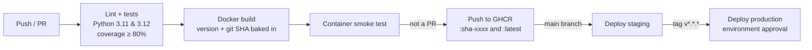

# GitHub Actions CI/CD Pipeline


A complete CI/CD pipeline for a small Python API, built with GitHub Actions. Every push is linted, tested on two Python versions, built into a Docker image, smoke-tested and published to GitHub Container Registry. Then it moves through **staging → production** using GitHub Environments.

> Portfolio project. The deploy jobs are fully written, but they skip themselves until real server secrets are added. No paid infrastructure is attached.

## Pipeline



## Features

- **Automated build and test:** a flake8 lint, then pytest with a coverage gate, on a Python version matrix.
- **Docker image creation:** the semantic version (from tags) or short SHA is injected with build args and exposed at `/version`.
- **Image smoke test:** CI starts the built image and checks it responds correctly before pushing.
- **Registry:** images are pushed to `ghcr.io/amanmasood/release-info-api` using the built-in `GITHUB_TOKEN`.
- **Environment-specific configuration:** `config/staging.env` and `config/production.env` set different ports and feature flags.
- **Promotion flow:**
  - `main` deploys to staging.
  - A `vX.Y.Z` tag deploys to production. The production environment can require a manual approval.
- **Safe deploy script:** `deploy/deploy.sh` pulls the image, swaps the container, waits for a passing health check, and rolls back automatically if it fails.

## Tech stack

GitHub Actions · Docker · GHCR · Bash · Linux · Python · Flask · Gunicorn · pytest

## Repository layout

```
src/app.py                 # API: /health, /version, /api/greeting/<name>
tests/                     # pytest suite
config/{staging,production}.env
deploy/deploy.sh           # zero-config remote deploy with health check + rollback
Dockerfile
.github/workflows/ci-cd.yml
```

## Run locally

```bash
pip install -r requirements-dev.txt
python -m pytest -q
docker build -t release-info-api . && docker run -p 8000:8000 -e APP_ENV=local release-info-api
curl localhost:8000/version
```

## Enabling real deployments

1. Prepare a Linux server with Docker installed, and create `/opt/release-info/`.
2. In the repo, go to **Settings → Environments** and create `staging` and `production`. Add required reviewers to `production`.
3. Add these secrets:

| Secret | Used by |
|---|---|
| `STAGING_HOST`, `STAGING_USER`, `STAGING_SSH_KEY` | deploy-staging |
| `PROD_HOST`, `PROD_USER`, `PROD_SSH_KEY` | deploy-production |

4. Push to `main` to deploy staging. Run `git tag v1.0.0 && git push --tags` to release to production.

## License

MIT
